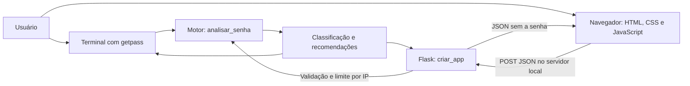

# FirePassJW — Verificador de Força de Senhas

Aplicação web em Python e Flask, com interface responsiva, barra de força,
indicadores de critérios e recomendações em tempo real. Também permite
analisar senhas pelo terminal.

A interface usa uma paleta azul, com fundos claros, destaques em azul e
indicadores de força que preservam vermelho e âmbar para níveis de alerta.

## Problema e solução proposta

Senhas curtas ou previsíveis podem parecer seguras apenas por conterem letras,
números e símbolos. O usuário precisa entender os sinais de fragilidade e
receber orientações práticas, sem gravar a senha em um arquivo ou depender
de um serviço externo de análise.

O projeto ajuda a reconhecer senhas curtas, pouco variadas ou dominadas por
padrões previsíveis. Ele fornece uma estimativa local e recomendações para
melhorar a escolha de uma senha. Na interface web, a entrada é enviada por
HTTP ao servidor Flask local para análise; não é enviada a serviços externos.

Avaliar comprimento, letras maiúsculas e minúsculas, números e caracteres especiais. As classificações possíveis são **Muito fraca**, **Fraca**, **Média**, **Forte** e **Muito forte**.

A solução proposta reúne o mesmo motor de análise em duas formas de uso:
terminal com entrada oculta e interface web com barra de força, critérios
atendidos e recomendações. A versão web atualiza os resultados após uma
pausa de 300 ms na digitação. O sistema estima características da senha;
não autentica usuários nem comprova que uma senha está protegida contra ataques.

## Stack

- Python 3.10 ou superior.
- Flask 3.1 para a interface web e as rotas HTTP.
- HTML, CSS e JavaScript sem dependências de frontend ou recursos de CDN.
- Biblioteca padrão: getpass, dataclasses, re e unicodedata.
- unittest e unittest.mock para testes automatizados.

O requirements.txt fixa versões exatas de Flask e suas dependências transitivas
validadas localmente. O requirements-prod.txt acrescenta Waitress 3.0.2.
O modo de terminal e seus testes continuam usando somente a biblioteca
padrão; o Flask é importado apenas ao criar a aplicação web.

## Como instalar e executar

Pré-requisito: Python 3.10 ou superior instalado e acessível no terminal.
Tenha os arquivos do projeto na pasta de trabalho. Os comandos abaixo são
para Windows com PowerShell.

No PowerShell:

```powershell
cd D:\Projeto_Lab
```

Se ainda não existir um ambiente virtual:

```powershell
python -m venv .venv
```

Ative o ambiente, instale as dependências e execute a interface web:

```powershell
.\.venv\Scripts\Activate.ps1
python -m pip install -r requirements.txt
python verificador_senhas.py --web
```

Abra **http://127.0.0.1:5000** no navegador. A análise é atualizada após
300 ms sem digitação. Use o botão de olho para mostrar ou ocultar a entrada
e Limpar análise para apagar o campo e reiniciar os indicadores.

Sem ativar o ambiente:

```powershell
.\.venv\Scripts\python.exe -m pip install -r requirements.txt
.\.venv\Scripts\python.exe verificador_senhas.py --web
```

Se a porta 5000 estiver ocupada, use outra pelo comando Flask:

```powershell
python -m flask --app verificador_senhas:criar_app run --host 127.0.0.1 --port 5001
```

### Modo de terminal

```powershell
python verificador_senhas.py
```

Digite a senha quando solicitado. A entrada fica oculta com getpass. Sem suporte a entrada oculta, o programa interrompe a leitura. Não passe senhas como argumentos do terminal. Pressione Ctrl+C para cancelar.

O limite de entrada é de 4096 caracteres. Códigos de saída:

| Código | Significado |
| --- | --- |
| 0 | Análise concluída, independentemente da força |
| 1 | Entrada indisponível ou inválida |
| 130 | Cancelamento com Ctrl+C |

Para desativar o ambiente:

```powershell
deactivate
```

## Testes automatizados

Com o ambiente ativado:

```powershell
python -m unittest discover -s tests -v
```

Sem ativar o ambiente:

```powershell
.\.venv\Scripts\python.exe -m unittest discover -s tests -v
```

A suíte Python possui 49 testes: 25 de análise e terminal, mais 24 da
interface Flask. Há também 15 testes JavaScript, totalizando 64 testes
executados localmente. Os cenários de navegador são separados dessa contagem.
Todos usam exemplos fictícios. Eles verificam:

- Limites de comprimento: 7/8, 11/12, 15/16, 19/20 e 27/28 caracteres.
- As cinco classificações e recomendações para cada categoria ausente.
- Repetições e sequências dominantes, inclusive maiúsculas e invertidas.
- Sequências minoritárias que não devem derrubar a nota de uma senha longa.
- Frases longas sem todas as categorias de caracteres.
- Espaços, controles, caracteres invisíveis e Unicode visível.
- Ausência da senha na saída e no resultado.
- Entrada oculta indisponível e cancelamento.
- Unicode canonicamente equivalente, com o mesmo resultado de análise.
- Entrada de exatamente 4096 caracteres, excesso e tipo inválido.
- O ponto de entrada principal em subprocessos, incluindo códigos de saída.
- Inicialização do modo web sem debug e orientação quando Flask não existe.
- Renderização da página, CSS, JavaScript e ícone local.
- Resultados HTTP iguais aos da análise de terminal.
- Critérios, validação JSON, tipos de entrada e limites de requisição.
- Ausência da senha nas respostas e nos logs exercitados pelo cliente de teste.
- Cabeçalhos de privacidade e bloqueio de hosts e origens externos.
- Identidade FirePassJW no título, cabeçalho e rodapé.
- Estado inicial dos controles, rótulos acessíveis e referências de IDs.
- Digitação com atraso, atualização da barra e dos critérios e limpeza da entrada.
- Respostas atrasadas, falhas HTTP, falhas de rede e tempo limite.
- Exibição e ocultação da senha e contagem de caracteres Unicode.
- Lista local de senhas conhecidas, sufixos e substituições triviais.
- Requisições concorrentes, entradas máximas, limites por IP e expiração.
- Restauração pelo histórico e rejeição de JSON malformado ou incompatível.

Sem Flask instalado, os 24 testes HTTP ficam marcados como ignorados.
Para validar a aplicação completa, instale requirements.txt e confirme
que nenhum teste foi ignorado.

Para executar os testes JavaScript, use Node.js 22 ou superior. Não é
necessário instalar pacotes com npm:

```powershell
node --test tests/test_frontend.cjs
```

Esses testes usam DOM, rede e temporizadores simulados; não abrem um navegador
nem substituem a validação visual de cores, fontes e responsividade.
A sintaxe também pode ser conferida separadamente:

```powershell
node --check static/app.js
```

Os testes de integração simulam getpass com exemplos fictícios. Eles verificam
o fluxo e a saída do executável; não comprovam a ocultação em cada terminal
real. Essa verificação continua dependendo de uma execução interativa.

O workflow `.github/workflows/tests.yml` executa a suíte no GitHub Actions
com Windows, Linux e macOS, em Python 3.10 e 3.14. Sua execução depende de
publicar o repositório no GitHub; criar o arquivo não significa que essa
matriz já foi validada.

### Testes em navegador real

Há sete cenários Playwright, executados em duas configurações de viewport:
desktop e celular, totalizando 14 execuções previstas. Eles usam o Flask real
em 127.0.0.1:5051 e verificam análise, senha comum, teclado, ausência de
rolagem horizontal, falhas da API, respostas inválidas e contraste dos textos
principais. Não substituem uma auditoria completa de acessibilidade.

```powershell
npm install --ignore-scripts
npx playwright install chromium
npm run test:e2e
```

A versão direta do Playwright está fixada em package.json. O package-lock.json
ainda não foi gerado porque o acesso ao registro npm foi bloqueado neste
ambiente. Após instalar, versione o lockfile para reproduzir a árvore completa.
O CI inclui um job separado de navegador, ainda sem execução confirmada.

O npm foi bloqueado e a tentativa de iniciar Chrome headless falhou por
restrições do ambiente. Por isso, os 14 cenários não foram executados aqui.
Se preferir o Chrome já instalado em uma máquina com permissão para executá-lo:

```powershell
$env:PLAYWRIGHT_BROWSER_CHANNEL = "chrome"
npm run test:e2e
```

Referência: [servidor web nos testes Playwright](https://playwright.dev/docs/test-webserver).

### Medição de desempenho

```powershell
python tools/benchmark.py --samples 40 --workers 4
```

A ferramenta usa apenas entrada sintética de 4096 caracteres e não grava nem
imprime a entrada. A medição usa o cliente Flask em memória, com aquecimento
prévio, e não inclui rede ou servidor WSGI externo. Na execução local em
Windows/Python 3.15.2: média de 38,10 ms, p95 de 133,27 ms e 83,28 requisições
por segundo, com 40 amostras e quatro workers. Valores dependem da máquina e
da carga; não representam capacidade garantida em produção.

## Arquitetura da aplicação

A aplicação tem separação lógica entre análise, apresentação e testes, mesmo
mantendo um único arquivo Python de aplicação na raiz. O motor de análise é
compartilhado pelos modos de terminal e web. Não há banco de dados, contas
de usuário ou armazenamento persistente de senhas.



| Componente | Responsabilidade |
| --- | --- |
| verificador_senhas.py — executar e main | Selecionar o modo, receber a entrada oculta e retornar códigos de saída |
| verificador_senhas.py — analisar_senha e funções internas | Validar, normalizar Unicode, avaliar critérios, aplicar bônus e penalizações e gerar recomendações |
| verificador_senhas.py — criar_app | Montar o Flask, renderizar a página, validar POST /api/analisar e aplicar limites e cabeçalhos |
| templates/index.html | Estrutura, rótulos e controles da interface FirePassJW |
| static/app.js | Atraso de 300 ms, requisições, cancelamento, validação da resposta e atualização visual |
| static/style.css e favicon.svg | Paleta azul, tipografia, foco e adaptação do layout |
| tests/ | Testes unitários, CLI, HTTP, JavaScript simulado e cenários de navegador |
| tools/benchmark.py | Medir requisições WSGI em memória com entradas sintéticas |
| .github/workflows/tests.yml | Definir a matriz Python e o job de navegador, pendentes de execução no GitHub |

No fluxo web, GET / entrega a página e os arquivos estáticos. Após a pausa
de digitação, o JavaScript envia a entrada no corpo de POST /api/analisar.
O Flask verifica origem, cota, formato JSON e tamanho; o motor calcula o
resultado; a resposta contém classificação, nível, comprimentos, critérios
e recomendações, sem devolver a senha.

O limitador mantém somente IPs e horários em memória, por processo. A senha
e suas representações intermediárias existem temporariamente na memória
durante a análise. A ausência de persistência não implica apagamento imediato
desses dados da memória.

## Regras de avaliação

Cada categoria presente soma um ponto de variedade: minúsculas, maiúsculas, números decimais e símbolos ou pontuação Unicode.

Antes da análise, o texto é normalizado em Unicode NFC para equiparar
representações canonicamente equivalentes. O limite de 4096 caracteres é
verificado na entrada original, antes dessa normalização.

Espaços, caracteres não imprimíveis e marcas combinantes restantes não
aumentam o comprimento avaliado nem a variedade. Eles apenas deixam de
contribuir para a estimativa; o programa não altera senhas de contas.

| Comprimento avaliado | Nível máximo |
| --- | --- |
| Menos de 8 | Muito fraca (0) |
| 8 a 11 | Fraca (1) |
| 12 a 15 | Forte (3) |
| 16 ou mais | Muito forte (4) |

O menor valor entre variedade e limite de comprimento define o nível base:
Muito fraca (0), Fraca (1), Média (2), Forte (3) ou Muito forte (4).

Para valorizar senhas e frases longas sem exigir todas as categorias, há um
bônus quando o texto avaliado contém pelo menos oito caracteres distintos,
desconsiderando diferenças de caixa:

- A partir de 20 caracteres avaliados: nível mínimo Forte.
- A partir de 28 caracteres avaliados: nível mínimo Muito forte.

A penalização por padrões previsíveis é aplicada depois desse bônus.

A nota fica limitada a Fraca quando houver:

- Repetição integral de um bloco, como Ab1!Ab1!Ab1!Ab1!.
- Repetições consecutivas de quatro ou mais caracteres ou sequências que,
  somadas, cubram pelo menos metade do texto avaliado. Posições sobrepostas
  contam apenas uma vez.

As sequências reconhecidas são trechos de quatro caracteres do alfabeto
latino, números e fileiras do teclado qwerty, inclusive invertidos e sem
distinguir maiúsculas de minúsculas. Um pequeno trecho previsível em uma
senha longa deixa de provocar a penalização sozinho.

A lista local ilustrativa em SENHAS_COMUNS e SENHAS_NUMERICAS_COMUNS limita
as entradas reconhecidas a Muito fraca. A comparação também considera caixa,
acentos, espaços descartados, prefixos/sufixos numéricos e símbolos, além de
substituições simples como @ por a e 0 por o. Não se faz busca de palavras
comuns dentro de toda frase, para evitar penalizar uma frase distinta apenas
por conter uma delas. A lista é pequena, curada para o projeto, e não é uma
base de senhas vazadas nem uma garantia de detectar todas as escolhas comuns.

Os limites, níveis e sequências estão definidos em constantes no verificador_senhas.py para facilitar a manutenção.

## Segurança e limitações

- A entrada aceita até 4096 caracteres antes da normalização Unicode.
- O modo de terminal exige suporte a entrada oculta. Sem esse suporte,
  encerra a leitura e retorna código 1. A interface web usa um campo password,
  com exibição opcional controlada pelo usuário.
- A interface web depende de JavaScript e envia a entrada no corpo JSON de
  POST /api/analisar, nunca como parâmetro de URL.
- A aplicação não grava senhas em arquivos, banco de dados, logs ou
  armazenamento do navegador. O código não inclui analytics ou recursos
  de terceiros. A análise web trafega entre o navegador e o servidor local.
- As respostas têm Cache-Control: no-store; o frontend cancela análises
  antigas e impede que uma resposta atrasada substitua a análise atual.
- As requisições HTTP têm limite de 64 KiB, além do limite de caracteres.
- A análise HTTP aceita até 90 requisições por IP em uma janela móvel de
  60 segundos. O excesso retorna 429 com Retry-After. Os contadores são
  protegidos contra concorrência e limitados a 1024 clientes por processo.
  Não armazenam senhas e não confiam em X-Forwarded-For.
- O resultado não contém a senha: inclui classificação, recomendações e,
  na interface web, critérios e comprimentos.
- A senha existe temporariamente na memória. Remover uma referência com del não garante apagar seus bytes; Python não oferece essa garantia para strings.
- A avaliação é heurística; os limites de diversidade e de predominância
  reduzem falsos positivos, mas não os eliminam.
- Não há consulta a vazamentos; a lista local de senhas comuns é ilustrativa.
- A classificação não garante resistência a ataques. Uma frase conhecida
  pode receber nota alta, pois não há análise de significado ou popularidade.

Use senhas exclusivas para cada conta, um gerenciador de senhas e autenticação em dois fatores.

### Escopo da versão web

O comando --web inicia somente em 127.0.0.1, com debug desativado, e aceita
hosts locais. Essa configuração se destina ao uso local. Para publicação,
é necessário revisar hosts permitidos, configurar HTTPS e um servidor WSGI
de produção, limitar requisições e garantir que proxies e ferramentas de
monitoramento não capturem corpos de requisição. O servidor de desenvolvimento
do Flask não deve ser usado em produção.

Para preparar um servidor WSGI local com Waitress:

```powershell
python -m pip install -r requirements-prod.txt
waitress-serve --call --listen=127.0.0.1:8000 verificador_senhas:criar_app
```

A instalação do Waitress não foi possível neste ambiente; esse comando ainda
precisa ser validado no destino. A receita mantém o servidor em loopback e
não configura certificados ou publicação. Para acesso externo, use HTTPS
em um proxy com domínio e certificados próprios. Configure os hosts permitidos
explicitamente na fábrica, em vez de liberar todos os hosts.

O limitador em memória não é compartilhado entre processos, reinicia junto
com a aplicação e descarta clientes antigos quando atinge o limite de memória.
Em implantação com vários processos, use também um limitador no proxy ou
armazenamento compartilhado. IPs compartilhados podem dividir a mesma cota.

Referência: [execução com Waitress](https://docs.pylonsproject.org/projects/waitress/en/stable/usage.html).

O navegador, extensões e gerenciadores de senhas podem manter dados fora do
controle da aplicação. Prefira exemplos fictícios. A limpeza do campo não
garante eliminação imediata das cópias temporárias em memória.

Referências: [início rápido do Flask](https://flask.palletsprojects.com/en/stable/quickstart/)
e [considerações de segurança](https://flask.palletsprojects.com/en/stable/web-security/).

## Como a IA foi usada no processo

O desenvolvimento foi assistido pelo Codex a partir das solicitações do
usuário. A aplicação em execução não usa modelo de IA ou API externa para
avaliar senhas; o modo web se comunica apenas com o servidor Flask local.

### Onde a IA acelerou o desenvolvimento

- Geração da primeira implementação, com getpass, classificação e recomendações.
- Criação da interface Flask, dos estilos, da barra e das atualizações ao digitar.
- Proposição e implementação de ajustes para Unicode, padrões previsíveis,
  lista de senhas comuns e limitação de requisições.
- Criação e execução de testes Python e JavaScript, refatoração e benchmark.
- Preparação da documentação, dependências fixadas e workflows de CI.

O ganho observado foi produzir e revisar esses artefatos de forma iterativa.
Não houve medição comparativa de tempo com e sem IA; portanto, não se atribui
um percentual de produtividade ao uso da ferramenta.

### Onde a revisão humana foi decisiva

As intervenções registradas do usuário foram decisivas para produto, escopo
e critérios de entrega:

- Definir a privacidade como requisito: entrada oculta e ausência de gravação
  ou registro de senhas.
- Corrigir o escopo quando a API de saúde deixou de ser necessária e,
  posteriormente, solicitar a transformação em aplicação web Flask.
- Pedir um único arquivo Python principal na raiz, preservando os testes
  separados da aplicação.
- Definir o nome FirePassJW, a paleta azul, o fundo e o tamanho das fontes.
- Exigir testes, análise de riscos e documentação que explicasse limites e IA.

Essas decisões humanas orientaram as mudanças. A revisão técnica do código
e os testes apresentados nesta conversa foram realizados com assistência
da própria IA. Não há registro de auditoria independente ou revisão humana
completa do código, nem de aprovação visual em navegador real. Essas etapas
continuam necessárias antes de tratar a aplicação como pronta para produção.

### Quais prompts funcionam melhor neste processo

As solicitações com contexto, escopo e critérios verificáveis produziram
entregas mais fáceis de conferir. Os exemplos abaixo são sugestões baseadas
nas solicitações desta conversa, e não transcrições literais ou resultado de
um experimento comparativo entre prompts.

**Para implementar uma funcionalidade:**

```text
No projeto atual, implemente a análise de comprimento, maiúsculas,
minúsculas, números e símbolos. Não grave nem registre a senha.
Mantenha o terminal funcionando e crie testes com exemplos fictícios.
```

Esse formato explicita o comportamento esperado, as restrições de privacidade
e a evidência exigida para considerar a implementação concluída.

**Para revisar riscos:**

```text
Com base no código e nos testes atuais, liste riscos técnicos restantes,
lacunas de cobertura e melhorias prioritárias. Para cada ponto, diferencie
um problema observado de uma possibilidade ainda não testada.
```

Esse formato orienta a revisão para os arquivos existentes e ajuda a separar
evidência de hipótese.

**Para executar e verificar melhorias:**

```text
Implemente as melhorias priorizadas, execute os testes afetados e atualize
o README. Informe os comandos usados, os resultados e o que não foi
possível validar no ambiente. Não declare uma etapa concluída só por
ter criado seu arquivo de configuração.
```

Esse formato relaciona mudança, verificação e documentação, além de tornar
visíveis os bloqueios de instalação, navegador ou CI.

### Quais riscos foram mitigados

| Risco | Mitigação implementada | Limite restante |
| --- | --- | --- |
| Exposição da senha em entrada ou saída | getpass no terminal, campo oculto na web, JSON sem eco da senha e testes de saída e logs | Memória, extensões e infraestrutura externa continuam fora dessa garantia |
| Nota alta para padrões previsíveis | Penalização de repetições, sequências dominantes e lista local de senhas conhecidas | Heurística e lista ilustrativa não cobrem todas as escolhas comuns |
| Divergência entre terminal e web | Motor e critérios compartilhados, com testes de igualdade dos resultados | Mudanças futuras exigem manter o contrato HTTP e os testes alinhados |
| Resposta antiga ou inválida na interface | Cancelamento, controle de revisão, validação do JSON e testes de falhas | Interação em navegador real ainda não foi executada |
| Abuso da rota de análise | Limites de corpo e caracteres, cota por IP e proteção de concorrência | Cota por processo não substitui proteção na infraestrutura pública |
| Instalações diferentes | Versões Python diretas e transitivas fixadas | Lockfile npm e validação da matriz de sistemas permanecem pendentes |
| Confundir código gerado com código verificado | Execução de testes, relato dos resultados e registro de etapas bloqueadas | Testes gerados pela mesma IA não constituem auditoria independente |

Na última validação registrada, 49 testes Python e 15 testes JavaScript
passaram sem falhas ou testes ignorados. Os testes HTTP usaram o cliente
Flask, e os testes JavaScript usaram DOM simulado. Os cenários Playwright,
o Waitress e a matriz do GitHub não foram validados neste ambiente.

Todos os exemplos de teste são fictícios. Não envie senhas reais em prompts,
argumentos do terminal, casos de teste ou evidências compartilhadas.

## Estrutura do projeto

```text
Projeto_Lab/
├── .github/
│   └── workflows/
│       └── tests.yml
├── .gitignore
├── CHANGELOG.md
├── README.md
├── requirements.txt
├── requirements-prod.txt
├── package.json
├── playwright.config.cjs
├── static/
│   ├── app.js
│   ├── favicon.svg
│   └── style.css
├── templates/
│   └── index.html
├── tests/
│   ├── e2e/
│   │   └── interface.spec.cjs
│   ├── test_cli.py
│   ├── test_frontend.cjs
│   ├── test_verificador_senhas.py
│   └── test_web.py
├── tools/
│   └── benchmark.py
└── verificador_senhas.py
```

O único arquivo Python na raiz é verificador_senhas.py, ponto de entrada da
aplicação. Os testes ficam separados em tests/. A pasta .venv e os caches
gerados pelo Python são ignorados pelo Git.

## Versionamento e validação

O Git ainda não está disponível no ambiente local de execução, e o
repositório não foi inicializado. Após instalar o Git, execute:

```powershell
git init
git status --short
```

Não há releases publicadas ou tags criadas. As versões do roadmap agrupam
funcionalidades; o histórico de alterações locais está em CHANGELOG.md.
Os testes locais foram executados com Python 3.15.2, Flask 3.1.3 e Node.js
24.22.1 no Windows. As demais
combinações de sistema e versão permanecem pendentes até executar a matriz
de integração contínua.

## Roadmap de releases

Planejamento sem datas de publicação definidas.

### v0.1.0 — Base implementada

- [x] Análise local com cinco classificações e recomendações.
- [x] Entrada oculta e testes automatizados.
- [x] Documentação e .gitignore.

### v0.2.0 — Melhorias implementadas

- [x] Penalização de repetições e sequências previsíveis.
- [x] Espaços e invisíveis desconsiderados na pontuação.
- [x] Códigos de saída para falhas e cancelamento.
- [x] Testes dos limites, recomendações e tratamento de entradas.
- [x] Imports organizados e regras centralizadas em constantes.
- [x] Modo de terminal sem dependências externas.

### v0.3.0 — Implementações locais e pendências

- [x] Normalização Unicode NFC.
- [x] Redução de falsos positivos para sequências minoritárias.
- [x] Valorização do comprimento com diversidade mínima.
- [x] Testes de integração do executável principal.
- [x] Workflow de testes para três sistemas operacionais.
- [x] Interface Flask responsiva com análise em tempo real.
- [x] Barra de força, critérios, recomendações e controles de visibilidade.
- [x] Testes HTTP e instruções de instalação do Flask.
- [x] Executar os 24 testes HTTP com Flask instalado.
- [x] Testar as interações JavaScript com DOM simulado.
- [ ] Validar visualmente a interface e sua interação em navegador.
- [x] Detectar senhas comuns usando uma lista local ilustrativa.
- [x] Limitar requisições por IP e testar concorrência.
- [x] Validar respostas JSON e restauração pelo histórico.
- [x] Fixar dependências Python e medir desempenho local.
- [x] Melhorar contraste, foco e tamanho dos controles.
- [x] Configurar testes Playwright e job de navegador.
- [ ] Executar os testes Playwright e gerar o lockfile npm.
- [ ] Validar Waitress no ambiente de destino e configurar HTTPS ao publicar.
- [ ] Permitir novas análises na mesma execução.

### v1.0.0 — Estabilização

- [ ] Validar Windows, Linux e macOS em versões suportadas de Python.
- [ ] Executar e confirmar a matriz de integração contínua no GitHub.
- [ ] Publicar notas de versão e orientações de contribuição.
